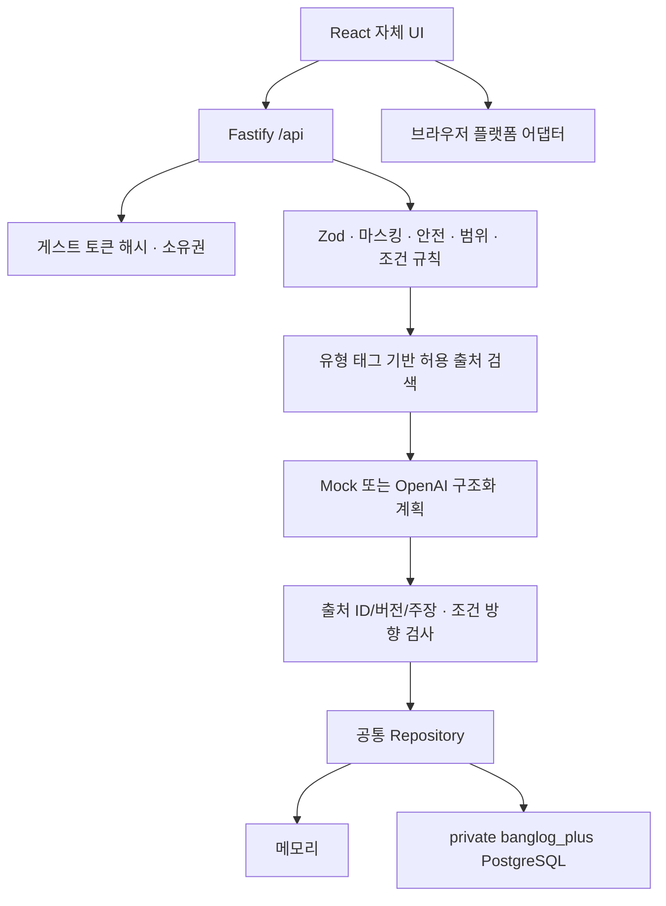

# 구조

## 클라이언트
`src/app/App.tsx`는 화면·입력 버전·요청 상태를 관리한다. 토큰은 `api.ts`의 메모리에만 존재하고 history에는 화면과 질문 번호만 넣는다. localStorage·sessionStorage·URL·쿠키에 토큰을 저장하지 않는다. `src/app/draft.ts`는 작성 중인 입력과 화면 위치만 해당 탭의 sessionStorage에 두어 새로고침·앱 전환 후 복원하며, 결과·동의 여부는 저장하지 않고 복원 시 스키마로 다시 검증한다. 질문 수정은 결과를 무효화하고 새로운 입력 버전을 만든다. HTML을 그대로 삽입하지 않는다.

`src/platform/`는 copy/openSource/back 인터페이스와 브라우저 구현을 제공한다. 토스는 검증된 bridge를 주입하는 경계만 있고 SDK 연동으로 표시하지 않는다. 실제 브라우저 뒤로가기는 popstate로 처리하며 로딩 중이면 취소를 요청한다.

## 서버·AI
검증 → 마스킹 → 소유권/멱등 저장 → 위험/범위 규칙 → 출처 검색 → 예산 예약 → 공급자 → 출력 내용 검증 → 활성 세션 확인 후 원자 저장.

OpenAI Responses `responses.parse` + Zod를 사용한다. 자유형 법률 문장 생성 대신 방향·승인된 주장 ID·출처 버전의 제한된 계획을 생성한다. 서버 규칙과 다른 방향, 없는 ID, 버전, 비표준 주장은 거부한다. 결과 문장·연락 문구는 서버의 검토 가능한 템플릿으로 조립한다. 이 방식은 모델이 새 사실을 만드는 범위를 줄이지만 규칙의 법률적 타당성까지 검증하지는 않는다.

모델명은 환경변수 필수. 외부 호출당 25초 timeout, 재시도 0, 출력 토큰 상한, store:false, 도구 없음. 키·DB 권한·임의 URL 접근은 모델에 전달하지 않는다. 위험·지원 범위 밖은 외부 호출하지 않는다.

## 저장·동시성
분석 생성 시 소유자+멱등키 및 소유자+입력버전 고유 제약. 완료·취소·실패 상태 분리. DB 최종 저장과 삭제는 부모 게스트 행 잠금으로 직렬화하며 삭제 후 결과 재생성을 막는다. 예산은 transaction advisory lock 아래 예약하고 불확실한 실패 비용을 되돌리지 않는다. 단일 서버 인스턴스 제한은 session advisory lock으로 적용한다. 메모리의 IP 제한은 서버 재시작 시 초기화되므로 공개 확장에는 공유 제한 계층이 필요하다.

## API
| Method | 경로 | 의미 |
| --- | --- | --- |
| GET | /api/config | 비밀값 없는 모드·설정 부족 목록 |
| POST | /api/sessions | 현재 고지 확인 후 비밀 토큰 발급 |
| POST | /api/analyses | 버전·멱등키를 가진 분석 |
| GET | /api/analyses/:id | 소유자의 입력·상태·결과 |
| POST | /api/analyses/cancel | 소유자의 진행 요청 취소 |
| POST | /api/analyses/:id/feedback | 완료 결과에 선택 피드백 |
| POST | /api/analyses/:id/events | 실제 복사 성공 이벤트 |
| DELETE | /api/session | 소유 세션과 연결 기록 삭제 |

Vite 프록시는 개발 전용. 빌드된 웹과 API 배포는 별도 설정한다. 공개 운영은 현재 비활성화되어 있다.
