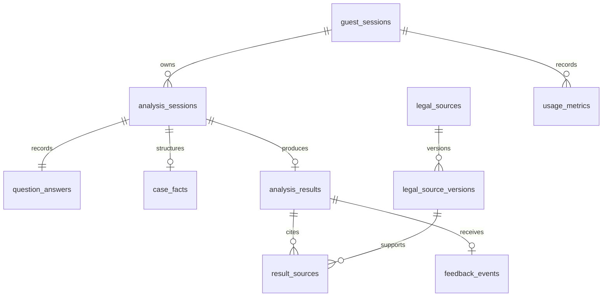

# DB 설계와 검증

접근 경로는 **서버 → pg 직접 PostgreSQL 연결 → 비공개 banglog_plus 스키마**다. Supabase Data API에 이 스키마를 노출하지 않는다. 브라우저에는 Supabase 키·DB URL을 넣지 않는다. HYUNDO Master 연결·프로젝트 ID는 제공받지 않아 조회하거나 추측하지 않았다. 원격 변경은 하지 않았다.

| 테이블 | 주요 필드·제약 | 보관·삭제 |
| --- | --- | --- |
| guest_sessions | UUID, 64자리 token_hash UNIQUE, expires_at, revoked_at, consent_version | 발급 24h 만료; 소유자 삭제·만료 정리 |
| analysis_sessions | guest_id FK, issue CHECK, audience=tenant CHECK, input_version, key, digest, input JSONB, state | 게스트 삭제 cascade; 소유자+키/입력버전 UNIQUE |
| case_facts | reported/unknown/conflicting JSONB, 복합 소유권 FK | 분석 삭제 cascade |
| question_answers | 답변 JSONB, question_version, 복합 FK | 분석 삭제 cascade |
| legal_sources | 실제 URL·기관·제목, source ID | 사용자 기록과 별도 보존 |
| legal_source_versions | PK(source_id,version), 위치·시행일·확인일·기술/사람 검토·범위 | 불변 트리거; 새 버전 삽입 |
| analysis_results | 입력·규칙·프롬프트·모델 버전과 결과 JSONB | 분석 삭제 cascade |
| result_sources | 실제 claim·위치·source/version FK·결과/소유자 복합 FK | 결과 삭제 cascade |
| feedback_events | 도움/이해/오류 유형 CHECK, 결과/소유자 복합 FK | 결과당 최신 피드백 1개; cascade |
| usage_metrics | 원문 없는 이벤트·모드·지연·토큰·비용 | 게스트 삭제 cascade; 이벤트별 중복 제외 |
| budget_ledger | 일자 PK, calls/tokens/usd 비음수 CHECK | 식별자 없는 누계, 예약 보존 |

## 권한
마이그레이션은 `banglog_plus_server` NOLOGIN/NOSUPERUSER/NOBYPASSRLS 역할만 생성한다. 공개·anon·authenticated에는 스키마 권한을 주지 않는다. 모든 11개 테이블에 ENABLE/FORCE RLS. API 트랜잭션은 `SET LOCAL ROLE banglog_plus_server`와 트랜잭션 한정 `banglog.guest_id`/`banglog.token_hash` 컨텍스트를 사용한다. 서버 인증이 확인한 값만 전달한다. 이 컨텍스트는 DB 자격증명을 가진 서버의 신뢰 경계이며 사용자 JWT가 아니다.

다른 게스트의 행은 SQL WHERE 소유권 조건과 RLS로 모두 제한한다. 단순 공개 UUID나 요청자가 보낸 userId는 권한이 아니다. SELECT/INSERT/UPDATE/DELETE를 분리된 소유권 검증 아래 수행한다. USING(true)·auth.uid()·SECURITY DEFINER 우회는 없다. 만료/철회 게스트는 정리용 정책으로만 전역 삭제 가능하며 활성 데이터는 노출하지 않는다.

원격 적용 승인 뒤에는 전용 LOGIN 역할을 만들고 위 역할의 멤버십과 해당 DB CONNECT만 부여한다. 앱 실행에 프로젝트 관리자/서비스 키·superuser 연결을 쓰지 않는다. 새 역할 생성·멤버십 설정 권한은 실제 Supabase 프로젝트에서 확인해야 한다. 스키마를 Data API에 추가하지 않아 REST 노출과 GRANT의 모순을 피한다.

## 로컬 실행
- `npm run db:test`: 임시 데이터 디렉터리와 임의 loopback 포트 생성 → SQL 적용 → 역할/RLS/외래키/예산/삭제/API 테스트 → 중지·자체 임시 파일 정리. 기존 DB에 접근하지 않는다.
- `npm run db:local`: `.local/`에 독립 persistent DB 생성, SCRAM 비밀번호, 제한된 앱 LOGIN, 초기 마이그레이션. 비밀값은 파일 권한 0600으로 저장.
- `npm run dev:db`: local env를 자식 개발 프로세스에만 전달.
- `npm run db:stop`: 생성한 로컬 클러스터를 정상 중지하고 데이터 보존.

마이그레이션 파일은 설치된 Supabase CLI 2.121.0의 `supabase migration new initial_banglog_plus`로 생성했다. Docker daemon이 실행되지 않아 Supabase 전체 스택을 띄우지는 않았다. 설치된 PostgreSQL 17.10으로 마이그레이션·실제 질의를 검증했다. 검사 SQL은 `supabase/tests/access-audit.sql`, 결과는 `db-test-results.json`이다. Supabase 프로젝트의 REST 게이트웨이나 CLI advisors 실행으로 오해하지 않는다.

## 정리·경합
인증은 만료 시각부터 즉시 차단한다. 물리적 정리는 실행 중 API의 1분 주기 또는 `npm run db:cleanup` 스케줄러가 수행한다. 따라서 DB 행 삭제는 최대 다음 정리 주기까지 지연될 수 있다. 서버 중단 중 정리 지연을 보장으로 숨기지 않는다. 공개 운영은 독립 scheduler·모니터링을 연결하고 실제 보관 고지와 맞춰야 한다.

삭제와 AI 완료는 게스트 행 잠금으로 직렬화한다. 삭제가 먼저면 결과 INSERT가 불가능하며, 저장이 먼저면 삭제가 cascade로 제거한다. 취소된 행은 완료 상태로 바뀌지 않는다. 공급자 데이터·백업까지 즉시 제거했다고 주장하지 않는다.
