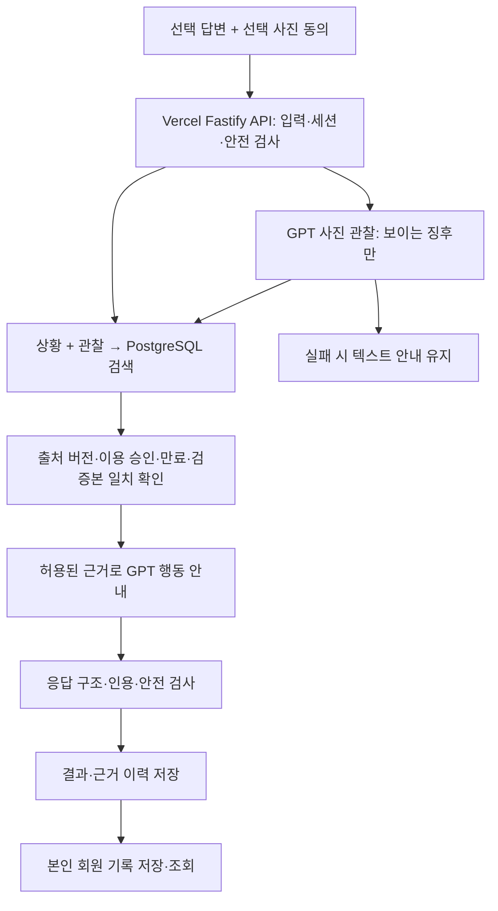

# 배포·사진·백엔드 점검 · 2026-11-10

## 배포
선택 통합 PR #2와 공개 DB TLS 인증서 보완 PR #3을 병합. 운영 코드 커밋 e6345173789b7765adffb7c2c9a5688d5ef579fb. 기존 PR #1 전체는 병합하지 않았다. 배포 결과와 실호출 검증은 아래에 추가한다.

## 백엔드 흐름

사진 원본은 DB 저장 필드에 넣지 않는다. 사진은 원인/과실 확정이 아닌 관찰용이다. 현재 검색은 유형 필터+증상/키워드 정렬, 최대 4문단이며 벡터 검색은 아니다. 사진 관찰은 검색 문맥과 GPT 입력 모두에 반영된다.

## 실제 DB 읽기 점검
- HYUNDO Master의 banglog_plus: 테이블 24개, 24개 모두 RLS 활성.
- 고유 출처 9개: 조문 3, 공식 안내 1, 판결 5.
- 출처 버전 14개: 내부 검토 11, 일반 조문 안내 3. 전문가 법률 검토 승인 0.
- 조각 14개: 옛 v1 4 + v2 7 + 일반 조문 3. 중복 버전 포함이므로 판례 14건이 아님.
- 현재 유효한 외부 AI 이용 허용 3개. 실제 공개 GPT 검색은 현재 조문 623·626·634 세 개에 한정.
- 소비자 자료 후보 12건은 검토 대기. 운영 법률 근거로 자동 사용하지 않음.

## 발견한 보완점과 우선순위
| 우선순위 | 항목 | 판단/다음 조치 |
|---|---|---|
| 완료 | 공개 DB CA 인증서 누락 | Git 배포에 필요한 파일을 포함. TLS 인증 검사는 유지 |
| 높음 | 상태창 knowledge.count=7 | 정적 v2 수치로 일반 조문/실제 공개 적격 수를 표현하지 못함. 등록·적격·검색·인용 수 분리 필요 |
| 높음 | 검색 세부 조건 | 배수 위치·범위·기시도 조치·수리 이력을 검색 순위에 명시 반영하고 12개 사례로 비교 |
| 높음 | 알 수 없는 오류 기록 | 일반 오류가 STORAGE_FAILURE로 합쳐짐. 내용·토큰 없이 코드/경로/소요시간 로그 보완 필요 |
| 중간 | DB 인덱스 | 외래키 6건 covering index 부족 알림. 실제 실행계획 후 추가 검토 |
| 중간 | RLS 성능 | 정책 15건에서 함수 재평가 알림. 소유권 유지하며 성능 개선 검토 |
| 중간 | 공유 Auth | 유출 비밀번호 차단 비활성 경고. 다른 서비스와 공유하므로 별도 범위 검토 |

Vercel에서는 이미 clientIp가 플랫폼 전용 헤더를 사용한다. trustProxy=false만 보고 모든 운영 사용자가 같은 IP라고 단정하면 안 된다. 다른 프록시 환경은 별도 설정 검토 필요. npm audit --omit=dev 결과 취약점 0건. Supabase 보안 점검에 Plus 전용 RLS 누락 알림은 없었으나, 이것이 모든 보안 검증 완료를 의미하지 않는다. 미사용 인덱스는 사용량이 적어서일 수 있으므로 삭제하지 않음. DB 구조/권한은 변경하지 않았다.

[외래키 인덱스 점검](https://supabase.com/docs/guides/database/database-linter?lint=0001_unindexed_foreign_keys) · [RLS 함수 평가](https://supabase.com/docs/guides/database/database-linter?lint=0003_auth_rls_initplan) · [비밀번호 보호](https://supabase.com/docs/guides/auth/password-security#password-strength-and-leaked-password-protection)

## 근거를 늘리는 실행 순서
1. **기존 판례부터**: 보일러·배관 94다34692, 구조적 결로 2010다89876, 곰팡이 통지 2014나13609, 원상회복 2023다249661, 임대 장비 2018다291347. 법률가에게 적용 조건·예외·주택 사건 여부를 검토받고 판결별 요약/주장 단위를 승인한다. 5건 전부 승인 시 현재 일반 조문3+판례5로 최대8개 고유 근거 활용 가능(승인 결과에 따라 달라짐).
2. **조문 보강 후보**: 민법627(일부 사용 불가), 615·654(반환/원상회복 연결), 624(보존행위). 공식 최신 원문·관련 조문·적용 한계를 교차 확인한 뒤 현재 일반 안내 절차로 추가. 627은 오늘 원문 확인했지만 자동 차임 공제·해지 안내로 단순화하지 않는다. 나머지는 아직 이번 검토에서 원문 재확인 전 후보이다.
3. **실행 안내 자료**: 현재 소비자 후보12개 중 배수/수선/연락 관련 항목부터 권리·출처·개정일을 확인. 생활 조치와 법률 판단 데이터를 구분한다.
4. **AI Hub 779건**: 로컬 후보군 유지 → 중복 사건번호 제거 → 주택/누수/곰팡이/배수 우선 → 공식 판결과 비교 → 이용조건·개인정보·외부 AI 전송 검토. 미확인 원본 일괄 업로드 금지.
5. DB 등록만으로 사용되지는 않는다. legal_sources → legal_source_versions → knowledge_chunks → source_permissions, 그리고 검색이 읽는 datasetVersion과 공식 조문 manifest를 함께 갱신해야 한다. 문단마다 원문 URL/위치/해시/확인일/이용조건/승인범위/예외/만료일을 기록한다.
6. 고정 평가 데이터는 유지하고 별도 12개 비교 사례에 정답 근거를 마련한다. 근거 검색 적중·인용 정합성·행동 구체성·근거 없는 단정·안전 실패를 비교한다. 목표는 자료 수보다 사례별 근거 커버리지다.

## 이번에 직접 확인한 공식 자료
- [민법627 최신 조문](https://www.law.go.kr/LSW/lsLinkCommonInfo.do?chrClsCd=010202&lsJoLnkSeq=1019572125): 일부 사용 불가의 조건과 감액 청구/해지 규정. 일반 안내 확장 후보.
- [2023다249661](https://www.law.go.kr/precInfoP.do?precSeq=237925): 토지/종전 시설물 사건. 주택 벽지 책임으로 바로 대입하지 않음.
- [2010다89876](https://www.law.go.kr/LSW/precInfoP.do?precSeq=164196): 가구전시장 결로 사건. 계약상 용도와 구조적 원인 확인이 중요.
- [2014나13609](https://www.law.go.kr/LSW/precInfoP.do?precSeq=174940): 다가구주택 결로·곰팡이와 통지 시점에 따른 손해 범위. 늦은 연락=모든 책임 면제로 단순화하지 않음.
- [생활법령 임대차](https://www.easylaw.go.kr/CSP/CnpClsMain.laf?ccfNo=4&cciNo=2&cnpClsNo=3&csmSeq=1171&menuType=cnpcls&popMenu=ov): 조문 비교 참고.

확인일 2026-11-10. AI 원문 대조는 법률가 승인과 다름. 이번에는 법률 자료를 새로 운영 등록하거나 승인 상태를 바꾸지 않았다.

## 운영 배포 확인
- Vercel dpl_HUAhLPeHjURPiYwudeyxgCoYisK1, production READY, banglog-plus.vercel.app alias 확인. v1.3.0 유지. 공개 인증서 보완 전 대기 배포는 취소했다.
- 운영 API/DB connected, 모바일390×844 사진 미리보기·삭제·후면카메라 속성·사진 없이 계속 가능·가로 넘침 없음. 실제 휴대폰이 아닌 Chromium 모바일 화면 검사.
- HTML 아이콘/manifest 연결 및 각 이미지 HTTP200.
- 회원 기록·관리자 회원 목록 비로그인 요청401, 공개 집계200. 실제 회원 재로그인/저장 조작은 이번에 수행하지 않음.
- 통합 코드 직전 전체 검사: 단위196, DB30, E2E43, 로컬데모8, 고정평가60 통과. 이후 변경은 기존 공개 CA 인증서의 배포 포함이며 운영 빌드와 DB TLS 실연결로 확인했다.

## 실제 GPT·사진 호출 결과
배포 커밋의 운영 서버에 합성 세면대 이미지와 회색 빈 이미지(음성 대조군)를 각각 전송했다. 사진 분석은 두 건 모두 정상 구조화 응답 `unclear`, 관찰 징후 빈 배열을 반환했다. 이는 사진 API 성공을 확인하지만 긍정적인 하자 인식 성능은 입증하지 않는다. 이전에 같은 합성 그림이 물 고임으로 분류됐던 기록과도 차이가 있어, 사진 일관성은 추가 평가가 필요하다.

두 사례 모두 gpt-6.1-sol이 DB의 공식 조문을 인용해 상황별 다음 행동을 생성했다. 고정 답변 전환 없음. 결과 재조회 성공, 조회 내용에 base64 원본 없음. 테스트 세션 삭제 완료. 검증 사용량은 비식별 운영 집계에 포함될 수 있다.

원본 하자 사진이 제공되지 않아 실제 세면대/곰팡이/벽지 사진 정확도는 미검증이다. 이후 동의받은 실제 사진으로 밝은 전체/근접 사진, 저조도, 무관 사진을 포함해 최소 12사례를 평가하고 관찰 정답과 대조한다. 합성 그림으로 성공률을 주장하지 않는다. 자세한 결과는 deployment-photo-review-20261110.json.
